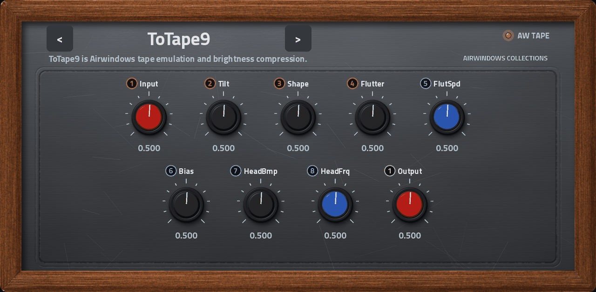
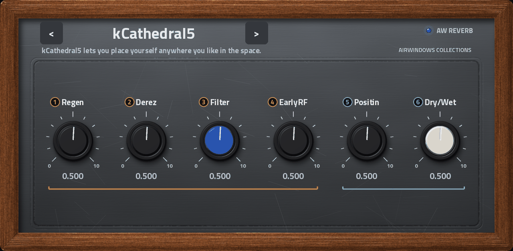
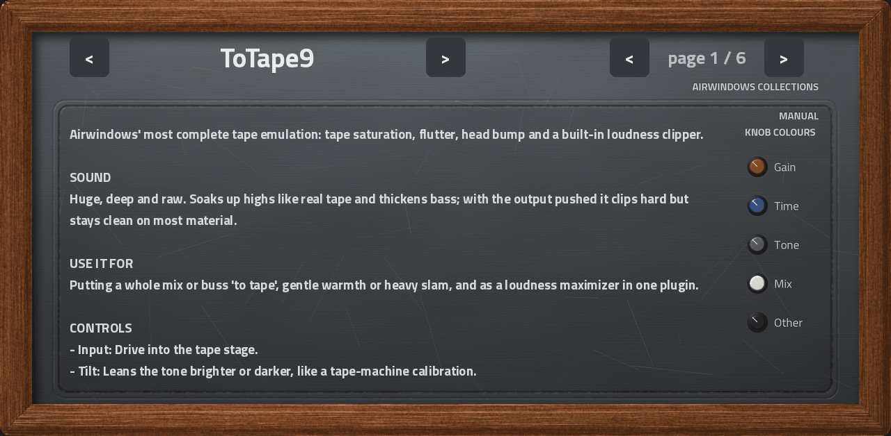
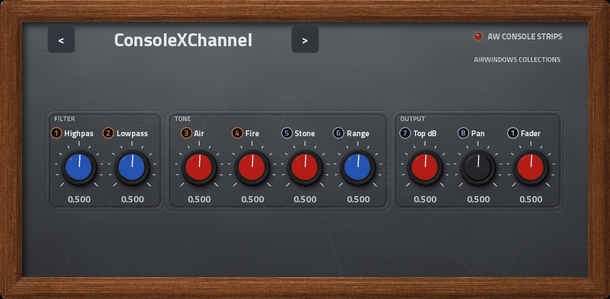
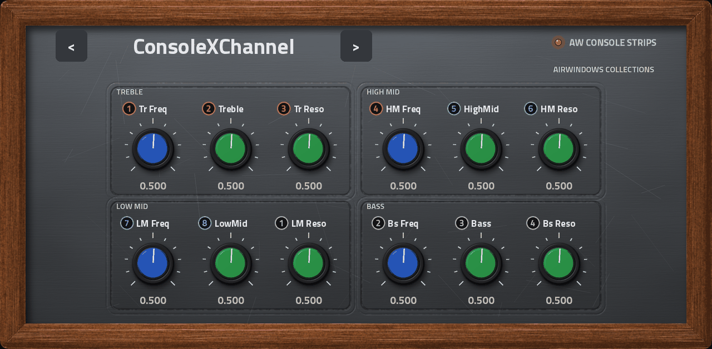
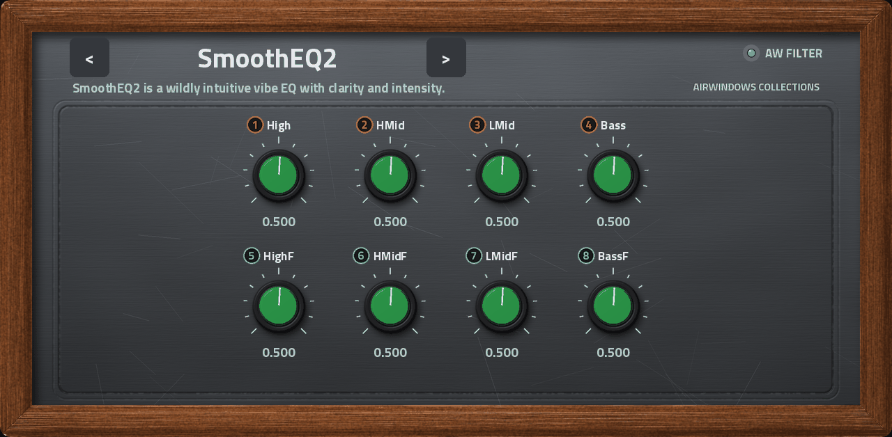

# Airwindows for MPC and Force

Chris Johnson's [Airwindows](https://www.airwindows.com) effects as native plugins for Akai MPC OS standalone devices
(MPC Live, One, X, Key and Force). Over 500 effects: reverbs, tape, filters, consoles, dynamics, distortion and more. Each one
has its own touchscreen panel with **numbered Q-Link badges**, and a built-in **manual** that explains the sound, what to use it
for, and what every knob does.

*Renders of the real skins (the same artwork the devices draw), shown with ToTape9 in AW Tape.*

## What you get

### One plugin per Airwindows category

There are over 500 Airwindows effects. Listing each in the MPC plugin browser would bury everything else, so there is
**one plugin per category**: AW Reverb, AW Tape, AW Filter, AW Dynamics and so on. Each holds every effect (model) in its
category, so you pick the model inside the plugin.

- **Model selector.** Step through models with the `<` `>` buttons beside the model name, or use the PRESET menu. Every
  model is also a preset with its own default settings. Each model remembers its own knob settings while you browse.
- **The right controls for each model.** Only that model's knobs appear. A model with 1 to 3 controls gets large knobs,
  and one with up to 14 gets two rows of smaller ones. Models with no controls say so.

### Q-Link badges

Every knob wears a small numbered badge. **The number is the Q-Link knob (1 to 8) that turns it**, so you can see at a glance
which hardware knob does what. The colour of the badge groups the knobs into banks: when a model has more than eight controls,
the badges restart at 1 in a new colour for the next bank. A line under a row of knobs links the ones that share a bank of
four Q-Links.

The Q-Links follow the page you are on, and one Q-Link knob is reserved for changing the model.

### Knob colours tell you what a control does

Knob caps are coloured by role, with a printed scale around each one:

| Colour | Meaning |
|---|---|
| Red | Gain, drive, level |
| Blue | Time, frequency, speed |
| Green | Tone, EQ, shape |
| White | Dry/wet and mix |
| Black | Everything else |

### Built-in manual

Every plugin has a **MANUAL** tab. For a growing number of models it opens with a plain summary written for this project:
what the effect is, how it sounds, what to use it for, and one line per control. Chris Johnson's original notes follow it. Where no
summary exists yet you see the original text, with a short control list.

### Console Strips: four real pages

A handful of models (ConsoleX and ConsoleH, the biggest Airwindows channel strips) have 20 to 37 controls. They live in **AW
Console Strips**, where the controls are grouped into sections (filter, tone, EQ, compressors, gates) over four real pages, each on
its own function key, so nothing is cramped.

| Page 1: filter, tone, output | Page 2: EQ |
|---|---|
|  |  |

### And

- **Float audio** straight from the host, with no 16-bit step.
- **The same look on every device**: a graphite panel in a walnut frame, drawn for this project.
- **Stays current.** New Airwindows plugins arrive through airwin2rack and are added to their category without moving existing
  parameters (see "Updating from Airwindows").

## Collections and status

| Collection | Plugin | Models | Manual summaries | Built | On devices |
|---|---|---|---|---|---|
| Ambience | AW Ambience | 26 | 26 of 26 | Force and Live III | Force: installed; Live III: installed |
| Amp Sims | AW Amp Sims | 18 | - | not yet | not yet |
| Bass | AW Bass | 10 | - | not yet | not yet |
| Biquads | AW Biquads | 9 | - | not yet | not yet |
| Brightness | AW Brightness | 26 | - | not yet | not yet |
| Clipping | AW Clipping | 9 | - | not yet | not yet |
| Console Strips | AW Console Strips | 8 | 8 of 8 | Force and Live III | Force: installed; Live III: installed |
| Consoles | AW Consoles | 50 | 49 of 50 | Force and Live III | Force: installed; Live III: installed |
| Distortion | AW Distortion | 15 | 14 of 15 | Force and Live III | Force: installed; Live III: installed |
| Dithers | AW Dithers | 23 | - | not yet | not yet |
| Dynamics | AW Dynamics | 35 | 35 of 35 | Force and Live III | Force: installed; Live III: built, install pending |
| Effects | AW Effects | 29 | 29 of 29 | not yet | not yet |
| Filter | AW Filter | 54 | 54 of 54 | Force and Live III | Force: installed; Live III: built, install pending |
| Lo-Fi | AW Lo-Fi | 21 | - | not yet | not yet |
| Noise | AW Noise | 9 | - | not yet | not yet |
| Reverb | AW Reverb | 42 | 42 of 42 | Force and Live III | Force: installed; Live III: installed |
| Saturation | AW Saturation | 20 | 17 of 20 | Force and Live III | Force: installed; Live III: installed |
| Stereo | AW Stereo | 12 | - | not yet | not yet |
| Subtlety | AW Subtlety | 20 | - | not yet | not yet |
| Tape | AW Tape | 12 | 12 of 12 | Force and Live III | Force: installed; Live III: installed |
| Tone Color | AW Tone Color | 17 | - | not yet | not yet |
| Unclassified | AW Unclassified | 1 | - | not yet | not yet |
| Utility | AW Utility | 38 | 38 of 38 | not yet | not yet |
| XYZ Filters | AW XYZ Filters | 24 | - | not yet | not yet |

528 models in 24 collections; 262 are built so far.

Status is the state of the author's own devices (an MPC Live III and a Force). "Installed" means copied, registered and loaded
there. Models with no upstream manual page (for example Spiral3, Weave and PunchyDeluxe) show a short note instead.
Full detail: [docs/STATUS.md](docs/STATUS.md).

## Installing

Releases carry one zip per plugin with its own installer (see the Releases page; the first release is a preview). Until then,
copy a built plugin to the device:

1. Put the plugin folder `Airwindows - VST - AW <Category>/` (the `.so`, `Plugin Skins/`, `version.xml`) and the shared
   `AW Skin/` folder into the device's `Synths` folder (`/sdcard/Synths` on a Force, `/nvme/Synths` on a Live III).
2. Register the plugin in `MPC.settings` (see [docs/DEVELOPING.md](docs/DEVELOPING.md)), then restart MPC.

The Force and other first-generation devices use the `armv7` build. The Live III and other second-generation devices use the
`aarch64` build. Both need root shell access, which stock MPC OS doesn't offer.

## Updating from Airwindows

`tools/vendor_airwin2rack.sh` pulls the latest source and manuals, `tools/gen_categories.py` adds new models to their category
(existing parameter positions never move), and the affected plugin is rebuilt. The current source is recorded in
`vendor/VENDORED.md`.

## Building and contributing

Building, the skin artwork pipeline, device quirks and the release recipe are in [docs/DEVELOPING.md](docs/DEVELOPING.md).
Build tools come from [mpc-vst-plugins](https://github.com/sd88me/mpc-vst-plugins). The manual summaries live in
`docs/summaries/<Category>.json`, one entry per model, written by hand from the original manual. Corrections are welcome.

## Licence and credits

This project (generator code, skin artwork, manual summaries) is MIT licensed, see `LICENSE`. The vendored Airwindows sources
keep their own licence in `LICENSE-airwindows.md`.

Airwindows plugins by Chris Johnson (MIT). Ported through [airwin2rack](https://github.com/baconpaul/airwin2rack) by Paul Walker
(MIT) and classified with help from [schwung-airwindows](https://github.com/charlesvestal/schwung-airwindows) by Charles Vestal.
The method of building native MPC screen skins as TUI pages is credited to @Locrian of the MockbaMod community (author of the Dexed+ port), whose work on skins and plugin folders underpins mpc-vst-plugins and so this project. Skin artwork is original to this project. Titillium Web (SIL Open Font License) is baked into the images.
